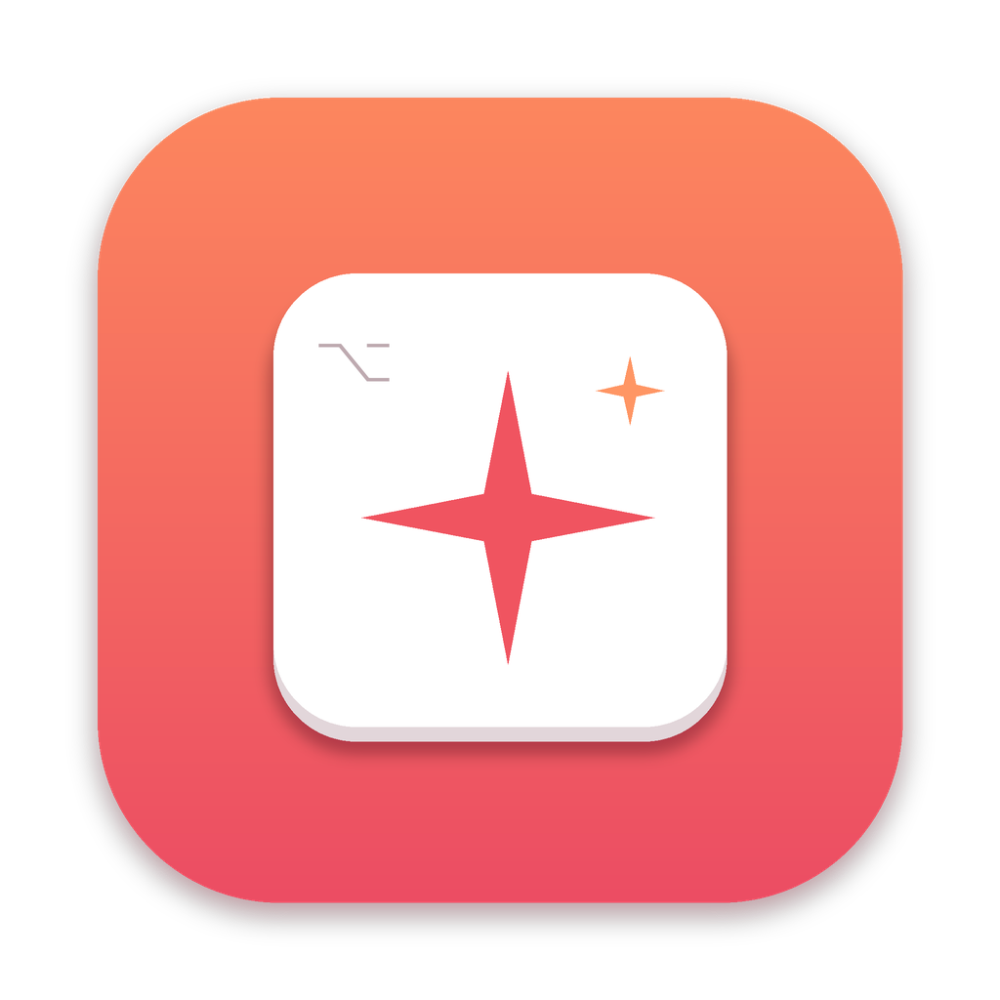

<h1 align="center">PasteKey</h1>

<b>好用的提示詞，一個鍵就貼出去。</b> macOS 選單列小工具，把你收藏的提示詞一鍵貼進 ChatGPT、Claude、Cursor 或任何 App。

<a href="README.md">English</a> · <a href="README_zh-Hans.md">简体中文</a> · <a href="README_ja.md">日本語</a>

---

- **任何地方按 ⌥ Space**：跳出類似 Spotlight 的面板，搜尋提示詞，按 Return 就貼到游標位置。
- **每條提示詞可單獨設定快速鍵**：常用的設成 ⌃⌥1 之類的組合鍵，按下直接貼上。
- **提示詞市集**：內建 24 條精選提示詞，7 個分類、中英雙語，一鍵加入。目錄從本倉庫即時更新。
- **變數**：`{{clipboard}}`、`{{input}}`、`{{date}}`、`{{time}}`，貼上時自動替換。
- **不弄亂剪貼簿**：貼上後還原原本的剪貼簿內容。
- **資料在本機**：提示詞存成本機 JSON，可匯出匯入。

在 [Releases](https://github.com/qiaoshouqing/pastekey/releases/latest) 下載 `PasteKey-1.0.0.dmg`。已通過 Apple 公證，需要 macOS 13 以上。自動貼上需在「系統設定 › 隱私權與安全性 › 輔助使用」中允許 PasteKey。

MIT © POMODIARY LLC
